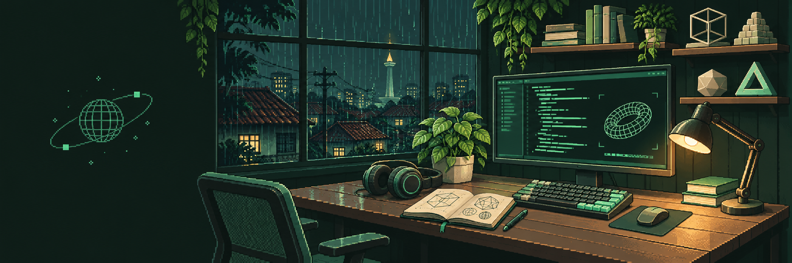

  

<h1 align="center">Hi, I'm Iqbal.</h1>

  <b>Iqbal Maulana Dhiti</b> 
  Informatics student · Web development · 3D &amp; motion 
  Based in Indonesia

  Turning ideas into interfaces, one experiment at a time.

  
  
  

---

### A little about me

I'm an Informatics student who enjoys building web applications and exploring the space between code, design, and interaction. My interests range from responsive interfaces and 3D web experiences to experiments with artificial intelligence.

- **Building:** web interfaces with React, TypeScript, and Tailwind CSS.
- **Exploring:** creative interactions with Three.js and GSAP, alongside AI projects.
- **Learning:** through personal projects, coursework, and hands-on experiments.

### My toolkit

**Interfaces & motion**

  
  
  
  
  
  
  
  

**Backend, data & tools**

  
  
  
  
  
  

### From my repositories

| Project | Focus |
| :--- | :--- |
| [BukuTamu](https://github.com/IqbalMaulMaul/BukuTamu) | TypeScript project |
| [NeuroScan AI](https://github.com/IqbalMaulMaul/brain-tumor-cnn) | Computer vision coursework · Python, CNN & explainable AI |
| [LimaWaktu](https://github.com/IqbalMaulMaul/LimaWaktu) | JavaScript project |

[Browse all repositories →](https://github.com/IqbalMaulMaul?tab=repositories)

### Coding activity

---

  <b>Have an idea? Let's build something together.</b> 
  <a href="mailto:iqbalmaulanadhiti@gmail.com">Email</a> ·
  <a href="https://instagram.com/iqbalmsdhiti">Instagram</a> ·
  <a href="https://github.com/IqbalMaulMaul">GitHub</a>

